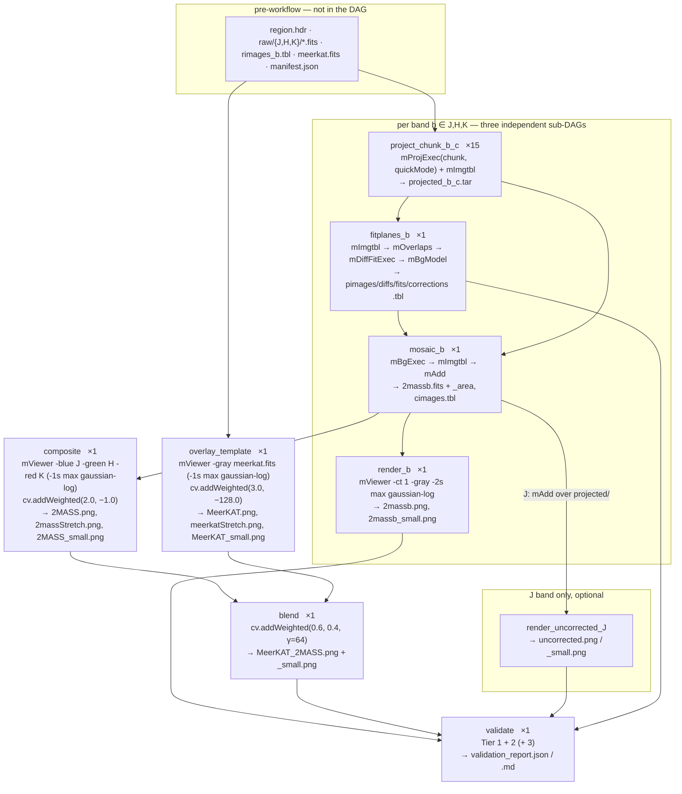

# SPEC — MeerKAT / 2MASS Mosaic Workflow (Pegasus)

**Project directory:** `$HOME/work/workflows/meerkat-2mass-mosaic/`
**Source of truth:** `$HOME/work/workflows/MeerKAT.ipynb` — *"Creating a Merger of a MeerKAT map of the
Galactic Center and a 2MASS mosaic created with the Montage Image Mosaic Engine"*, Good, Moseley &
Berriman (Caltech/IPAC-NExScI).
**Status:** implemented and running. First Pegasus run passed end-to-end; full three-band run in
progress ([§13](#13-build-order-and-progress)).

---

## 1. Goal

Convert the notebook into a Pegasus WMS workflow that produces the **same science products** —
three background-rectified 2MASS mosaics (J, H, K) on the MeerKAT pixel grid, a three-colour
composite, and a MeerKAT/2MASS blend — while:

1. exposing the parallelism the notebook hides inside Montage's serial `*Exec` loops,
2. keeping data acquisition **outside** the DAG, so the workflow re-runs without re-downloading ~4 GB,
3. producing a **machine-checkable comparison** against the notebook's own results.

### 1.1 What the notebook does

Per band `b ∈ {J, H, K}`, identically:

```
mArchiveDownload("2MASS b", location, size, raw/)   →  479 raw images
mImgtbl(raw/)                                       →  rimages.tbl
mProjExec(raw/, rimages.tbl, region.hdr, quickMode) →  projected/   (~471 usable)
mImgtbl(projected/)                                 →  pimages.tbl
mOverlaps(pimages.tbl)                              →  diffs.tbl    (2133 pairs)
mDiffFitExec(projected/, diffs.tbl, region.hdr)     →  fits.tbl
mBgModel(pimages.tbl, fits.tbl)                     →  corrections.tbl
mBgExec(projected/, pimages.tbl, corrections.tbl)   →  corrected/   (471)
mImgtbl(corrected/)                                 →  cimages.tbl
mAdd(corrected/, cimages.tbl, region.hdr)           →  2massb.fits (+ _area)
mViewer(-ct 1 -gray … -2s max gaussian-log)         →  2massb.png
```

then once, at the top level:

```
mViewer(-blue J -green H -red K, each -1s max gaussian-log)      →  2MASS.png
cv.addWeighted(2MASS.png,   contrast=2.0, brightness=-1.0)       →  2massStretch.png
mViewer(-gray MeerKAT.fits, -1s max gaussian-log)                →  MeerKAT.png
cv.addWeighted(MeerKAT.png, contrast=3.0, brightness=-128.0)     →  meerkatStretch.png
cv.addWeighted(tmassStretch, 0.6, meerkatStretch, 0.4, γ=64.0)   →  MeerKAT_2MASS.png
```

`region.hdr` is **extracted from the MeerKAT FITS** (`mGetHdr`), so every 2MASS mosaic lands on the
MeerKAT grid and the two PNGs are pixel-aligned by construction — which is what makes the final
`cv.addWeighted` blend meaningful.

### 1.2 Ground truth recovered from the notebook

All of the following is parsed out of the notebook's saved outputs by
`bin/extract_notebook_refs.py` into `reference/notebook_expectations.json` — not hand-transcribed,
so the reference cannot drift from the document it represents.

| Quantity | Value |
|---|---|
| Region centre (`mExamine.lonc/latc`) | `266.37081688220496  -29.22153052692637` |
| Region size | `3.2165880120000003` deg |
| Thumbnail shape | `961 × 1000` (all 7 thumbnails confirmed) |
| MeerKAT header cards | 38 |
| Raw images downloaded, J | 479 |
| Raw images in table (J / H / K) | 479 / 479 / 479 |
| `mProjExec` attempted, J | 479 (`failed=0`, `nooverlap=0`) |
| Overlap pairs, J | 2133 |
| `mDiffFitExec`, J | `count=2133`, `diff_failed=1`, `fit_failed=6` |
| Images in coadd, J (`mBgExec.count`) | **471** |
| Corrected images in table, J | **471** |
| Output mosaic size | **10121 × 10527** |
| J uncorrected stretch limits | `grayminval=27.89344589703572`, `graymaxval=11176.1787109375` |
| J uncorrected data range | `graydatamin=-41.0209846496582`, `graydatamax=11176.1787109375` |
| `BUNIT` (inherited from MeerKAT) | `JY/BEAM` |
| `mAdd` time, J uncorrected / corrected | 11.0 s / 10.0 s |
| Notebook wall clock | 13:26:10 → 14:16:36 ≈ **50 min** (Apple M2, 24 GB) |

Three findings from this that shape the design:

> **The notebook under-reports the projected count.** Cell 11 prints
> `"mImgtbl (projected): " + str(rtn)` but never assigns `rtn` from the `mImgtbl` call — it re-prints
> the `mProjExec` return. So "479 projected images" is *not* the projected count. The real figure is
> **471** (`mBgExec.count` and `mImgtbl(corrected).count` agree). **Roughly 8 of 479 raw images per
> band yield no usable projection**, and the workflow must treat that as normal
> ([§6.1](#61-soft-failure-policy)).

> **Per-pair failures are normal.** `diff_failed=1, fit_failed=6` for J. `mDiffFitExec` absorbs
> these; so must we.

> **The notebook ran MontagePy 2.2.0.** 2.2.0 was released 2024-05-05; 2.3.0 only on 2025-06-05; the
> notebook ran 2024-08-09. The container pins **2.2.0**, which is what makes the Tier 3 pixel
> comparison a like-for-like test rather than a comparison across Montage releases.

Only the J band prints full diagnostics — H and K print just the raw count — so H/K expectations
beyond `raw=479` are checked against the Tier 3 baseline rather than the notebook.

---

## 2. Decisions taken

| # | Question | Decision |
|---|---|---|
| Q1 | Task granularity | **Chunked `*Exec`** — split the image list into chunks and run the notebook's own `mProjExec` on each. ~60 DAG nodes. |
| Q2 | Validation tiers | **All three**, including the one-off serial baseline. |
| Q3 | Reprojection module | **Match the notebook** — `quickMode=True` retained. |
| Q4 | Execution target | **Local `condorpool`** on this 8-core / 29 GB host. |
| Q5 | Disk | Assumed the current volume (67 GB free) with `--cleanup inplace`; **see [§10](#10-remaining-question)**. |
| Q6 | MeerKAT input | URL live; fetched by `bin/prefetch.py` with resume + checksum. |
| Q7 | Uncorrected J mosaic | **Reproduce it**, behind `--skip-uncorrected`. |
| Q8 | Parameterisation | **Parameterise** survey, bands, region, template, chunk size. |

**Q1 = chunked retires most of the project's technical risk.** The chunked path calls essentially the
modules the notebook calls — `mProjExec`, `mImgtbl`, `mOverlaps`, `mBgModel`, `mBgExec`, `mAdd`,
`mViewer` (the one substitution, forced by a broken binding rather than by the design, is
[§9.1](#91-montagepy-220-api-realities)) — so:

- Montage still chooses the reprojection module per image, which is what Q3 ("match notebook") means
  in practice. No `mProjectQL`-vs-`mProject` decision to get wrong.
- The `mProjectQL` area-file unknown, and the `mDiffFit` / `mConcatFit` / `mBackground` signature
  unknowns that a per-image DAG would have depended on, **no longer apply at all**.
- Per-item failure tolerance stays inside Montage, where the notebook already relies on it.
- Area files (`X_area.fits`) never have to be named or declared individually — they travel inside
  the chunk archives ([§4.3](#43-why-chunks-are-shipped-as-tar-archives)).

The cost is coarser scheduling and chunk-level rather than image-level retry. Given Q4 (a single
8-core host) that costs almost nothing: see [§4.5](#45-why-only-reprojection-is-chunked).

---

## 3. Pre-workflow data acquisition — `bin/prefetch.py`

Run once, inside the container. Idempotent; a second run downloads nothing.

| Step | Action | Output |
|---|---|---|
| 1 | Download the MeerKAT mosaic (~1 GB), resuming via HTTP `Range`, rejecting anything under 500 MB as a failed transfer | `data/meerkat/MeerKAT_Galactic_Centre_1284MHz-StokesI.fits` |
| 2 | `mGetHdr` | `data/region.hdr` |
| 3 | `mExamine` → centre, size, thumbnail shape | `data/region.json` |
| 4 | `mArchiveDownload("<survey> <band>", location, size)` per band | `data/raw/{J,H,K}/*.fits` |
| 5 | `mImgtbl` per band, **rows sorted by filename** | `data/tables/rimages_{J,H,K}.tbl` |
| 6 | Record every input's size and SHA-256, plus the container's package versions | `data/manifest.json` |

```bash
apptainer exec Apptainer/Montage_Container.sif bin/prefetch.py
apptainer exec Apptainer/Montage_Container.sif bin/prefetch.py --verify
```

- **Idempotent** — a band whose files all match the manifest's names and sizes is skipped.
  `--force`, `--force-band K` override; `--template-path` adopts an already-downloaded MeerKAT file
  by symlink instead of downloading.
- **`--verify`** re-hashes every input and exits non-zero on drift, so a comparison run can *prove*
  it used the same inputs. Note the SHA-256s are self-recorded on first download (no published
  checksum exists for the archive file), so they establish run-to-run consistency, not authenticity.
- **The manifest is the contract with the generator.** `workflow_generator.py` builds the Replica
  Catalog from it and never scans a directory, so a run's inputs are exactly what was recorded.
- `region.hdr` is produced here, so **no workflow job stages the 1 GB MeerKAT file merely to read a
  38-card header**. The one job that genuinely needs its pixels is `overlay_template`.

Footprint: ~2.9 GB of 2MASS raws (1437 × ~2 MB) + 1 GB template ≈ **4 GB**, written once.

---

## 4. Workflow DAG

### 4.1 Shape



### 4.2 Job inventory

With the default `--proj-chunk-size 32` and 479 images per band → 15 chunks per band.

| Transformation | Instances | Does | Peak RSS measured | Requested |
|---|---:|---|---:|---|
| `project_chunk` | 15 × 3 = **45** | assemble `raw/` from staged files → `mProjExec(quickMode=True)` → `mImgtbl` → tar | 0.09 GB | 2 GB, 1 core |
| `fitplanes` | **3** | untar → `mImgtbl` → `mOverlaps` → `mDiffExec` → `mFitExec` → `mBgModel` | 0.35 GB | 4 GB, 2 cores |
| `mosaic` | **3** | untar → `mBgExec` → `mImgtbl` → `mAdd` (+ uncorrected `mAdd` for J) | 0.10 GB | 2 GB, 1 core |
| `render` | **4** | `mViewer -gray` + `cv.resize` thumbnail | 2.31 GB | 5 GB, 1 core |
| `composite` | **1** | 3-colour `mViewer` + `cv.addWeighted` stretch | 2.31 GB | 5 GB, 1 core |
| `overlay_template` | **1** | `mViewer -gray` on the 852 MB template + stretch | 2.31 GB | 5 GB, 1 core |
| `blend` | **1** | `cv.addWeighted` blend | 1.61 GB | 4 GB, 1 core |
| `validate` | **1** | Tier 1/2/3 comparison | — | 4 GB, 1 core |

**59 jobs exactly**, as generated; widest level 45.

> **The 6 GB slot ceiling is the binding constraint, and it fails silently.** This pool advertises
> slots of 4 CPUs / 6144 MB (×3) and 2 CPUs / 2048 MB (×1). A request above 6 GB matches no slot, so
> the job sits **idle forever** rather than failing. An earlier estimate-based version of this table
> asked 8–12 GB for `mosaic`, `render`, `composite` and `overlay_template`; all four would have hung
> indefinitely. The values above are measured peak RSS with ~2× headroom, all under the ceiling.
> Run `condor_status -af Name Cpus Memory` before raising any of them.
>
> Two measurements were worth having: `mAdd` peaks at **0.10 GB** on a 10121×10527 mosaic because it
> streams by row and never holds a full plane — so the coadd is far cheaper than it looks. Only
> `mViewer` genuinely holds full planes, which is why the render stages are the expensive ones.

No Pegasus clustering is needed. That is a direct consequence of Q1: the per-image alternative was
~9 280 jobs whose 2–5 s scheduling overhead each would have exceeded the notebook's entire runtime
on 8 cores, making horizontal clustering mandatory rather than optional. Chunking achieves the same
batching in the DAG itself, where it is visible and tunable via one flag.

This still holds under archive mode (§4.2.1). Clustering collapses sibling jobs of one
transformation into one clustered job, and the 45 `project_chunk` jobs are already batches of 32
images: `clusters.size=N` on them is arithmetically identical to multiplying `--proj-chunk-size` by
N, only less visible and not settable from the command line. Clustering would become necessary only
if the fetch were split into its own per-image job — 1 437 tiny download jobs — which is precisely
why archive mode keeps the fetch inside `project_chunk`.

#### 4.2.1 Archive mode — where the raw pixels come from

Archive mode — `bin/prefetch.py`'s default since 2026-09-02 — supplements the per-band
`mArchiveDownload` + `mImgtbl` with an `mArchiveList` query: a catalog lookup returning the image
list and a URL per image, no pixels. The manifest records URLs, `workflow_generator.py` registers
them as replicas on site `irsa` with input staging bypassed, and each `project_chunk` job pulls its
own images on the worker node. This is montage-workflow-v3's data-staging design (it registers
`rc.add_replica('ipac', fits, row['URL'])` and lets `pegasus-transfer` do the HTTP GET).

"Supplements" rather than "replaces" because of §4.2.1(1) below: the band's WCS table can only come
from `mImgtbl` reading real FITS headers, so archive mode **bootstraps** a band that has no table
by downloading it exactly once, hashing every image, and only then querying. The bootstrap's
SHA-256s are carried into the URL replicas, which is what makes each run-time download
integrity-checkable; listing blind would forfeit that. `--mode prefetch` opts out and keeps the
local copy as the DAG's actual input.

What it changes and what it does not:

| | archive (default) | prefetch (`--mode prefetch`) |
|---|---|---|
| Raw data required on the submit host | none after bootstrap | ~2.4 GB |
| Downloads | every run | once, reused across every run |
| Fetch parallelism | one connection per running chunk job, unthrottled | serial, through one condorio staging directory |
| Integrity | bootstrap checksums carried into the URL replicas | SHA-256 per input, `--verify` proves two runs used identical data |
| Failure mode | mid-DAG | visible before submit |
| Job count and DAG shape | **identical** | — |

Three things were learned the hard way on the cluster (2026-09-02) and are worth keeping:

1. **`MontagePy.mArchiveList` is not the CLI `mArchiveList`.** The binding's signature is
   `(dataset, location, size, output)` — same shape as `mArchiveDownload` — and it writes **JSON**:
   `[{"file": ..., "url": ...}]`, two fields, **no WCS**. The command-line tool writes a full
   `fitshdr` IPAC table, which is what montage-workflow-v3 feeds to `mDAGTbls`. This container is a
   pip-only MontagePy 2.2.0 install with no Montage executables, so there is no way here to obtain
   image WCS without the pixels — and `mProjExec` needs the WCS. **Archive mode therefore still
   requires the band's `mImgtbl` table**, i.e. the band must have been downloaded once. What it buys
   is deleting the pixels afterwards and keeping the 263 KB table.

2. **Bypass must be per-input, and the global property is not a usable fallback.**
   `pegasus.transfer.bypass.input.staging=true` bypasses *everything*, including the stageable
   wrappers in `bin/`, which are declared with submit-host pfns. PegasusLite then tries to fetch
   `/home/.../bin/project_chunk.py` on the worker and fails with `Expected local file does not
   exist` after three attempts and ~450 s of backoff. The wrapper never runs, so it writes no
   `status.json`, and the job surfaces as a stage-**out** failure naming the missing status file —
   saying nothing about the real cause (§6.1's soft-failure trap in a new guise). Worse, it is
   placement-dependent: chunk `c01` landed on a worker sharing the submit host's filesystem and
   passed while `c00` failed, in the same run.

   Pegasus 5.1.2 puts per-input bypass on **`Job.add_inputs(..., bypass_staging=True)`** — *not* on
   `ReplicaCatalog.add_replica`, which has no such parameter. The generator sets it on the raw
   images alone, so the chunk table, `region.hdr` and the support modules keep the normal condorio
   path. If the API lacks that parameter the generator refuses to build an archive-mode DAG rather
   than falling back to the broken global flag.

3. **Archive downloads are byte-identical to prefetch files.** `mArchiveDownload` does not
   decompress: the `.fits` files it writes are gzip bytes under a `.fits` name, exactly what
   `pegasus-transfer`'s `wget` produces from the same URL, and Montage's cfitsio reads them
   transparently. So checksums recorded by a prefetch run validate archive downloads unchanged, and
   the two modes feed identical bytes to `mProjExec`. Verified: a 16-image band-J run in each mode
   produced **byte-identical** `2massj.fits` (852 MB), `uncorrected.fits` and all five `_J.tbl`
   tables.

**The gate.** Because both modes share one table, row order is not in question — what is, is whether
the archive still offers a URL for every image the table names. `bin/prefetch.py --compare-tables`
checks exactly that, non-destructively. Measured 2026-09-02: 479/479 in each of J, H, K.

The ~1 GB MeerKAT template is downloaded in both modes: `region.hdr` and `region.json` come from
`mGetHdr`/`mExamine` on it at generation time, and `overlay_template` needs the pixels. Archive mode
removes the 2MASS raw data, not the template.

Prefetch remains the default because everything in `DETERMINISM.md` rests on checksummed inputs
reused byte-for-byte across runs, which archive mode cannot offer on a clean tree.

### 4.3 Why chunks are shipped as tar archives

`mProjExec` names its outputs itself, and ~8 inputs per band produce no output at all. Declaring
individual projected FITS as Pegasus outputs would therefore mean predicting Montage's naming
convention *and* declaring ~958 files per band as optional. Instead each chunk job emits **one**
deterministic archive, `projected_<band>_c<nn>.tar`, containing whatever `mProjExec` produced —
image and `_area` files together.

This buys three things:

- The declared output always exists, whatever happened inside, so no optional-output semantics.
- Area files never have to be named or reasoned about; they travel with their images.
- Pegasus stages 15 files per band instead of ~958, avoiding per-file transfer overhead on the two
  jobs that consume the whole set.

Archives are uncompressed: the consumers are on the same host, and gzip would trade ~5 GB of disk
for CPU on the critical path. `--compress-chunks` is available if [§10](#10-remaining-question)
turns out to need it.

### 4.4 Tables are rebuilt, never merged

The authoritative `pimages.tbl` is produced by `fitplanes_b` running `mImgtbl` over the directory it
just assembled from all chunk archives — exactly as the notebook does it. `cimages.tbl` likewise
comes from `mosaic_b` running `mImgtbl` over its own `corrected/` directory.

So no job ever merges IPAC tables by hand, and `mImgtbl`'s `badfits`/`badwcs` skipping continues to
do the failure filtering it does in the notebook. `bin/mtbl.py` exists only for the submit host: it
sorts `rimages.tbl` deterministically and splits it into per-chunk tables at DAG-generation time.

### 4.5 Why only reprojection is chunked

From the notebook's own timestamps, per band:

| Stage | Notebook time | Chunked? |
|---|---|---|
| `mProjExec`, 479 images | **~7 min** | **yes — 15 chunks** |
| `mOverlaps` + `mDiffFitExec`, 2133 pairs | ~80 s | no |
| `mBgModel` | seconds | no (global iterative fit — inherently serial) |
| `mBgExec` + `mImgtbl` + `mAdd` | ~30 s | no |
| `mViewer` | ~50 s | no |

Reprojection is ~85 % of per-band compute; everything after it totals ~2.5 min and *all of it needs
the same 3 GB working set*. Splitting those stages further would add a 3 GB re-stage per split to
save seconds. The one split that does earn its place is `fitplanes` → `mosaic`: it costs one
re-stage but yields tiny table-only outputs at the boundary (the notebook's own intermediate
artifacts, all staged out for comparison), a checkpoint at the expensive boundary, and honest
per-stage memory requests instead of one monolith demanding the maximum.

### 4.6 Data volumes

| Product | Per item | Count | Total |
|---|---|---:|---|
| Raw 2MASS | ~2 MB | 1437 | ~2.9 GB |
| MeerKAT template | 1 GB | 1 | 1.0 GB |
| Chunk archives (projected image + area) | ~205 MB | 45 | ~9.2 GB |
| Diff images | — | 6399 | **0 — transient inside `fitplanes`, never staged** |
| Corrected images | — | 1413 | **0 — transient inside `mosaic`, never staged** |
| Mosaics (10121×10527 ×8 B, image + area) | 1.7 GB | 3 (+1 uncorrected) | ~6.8 GB |
| Full-resolution PNGs | ~50–100 MB | ~6 | ~0.5 GB |
| **Peak on disk** | | | **≈ 30 GB** (≈ 45 GB transient with staged duplicates) |

Therefore:

- Plan with **`--cleanup inplace`**. Without it this workflow can fill the volume.
- `stage_out=False` on chunk archives and every intermediate.
- Chunking earns a second dividend here: diff and corrected images — 4 GB and 9 GB respectively in
  a per-image DAG — never become Pegasus files at all.

### 4.7 Parallelism realised

| | Notebook | Workflow |
|---|---|---|
| Bands | strictly sequential (J, then H, then K) | 3 independent sub-DAGs |
| Reprojection | serial loop over 479 images | 15 parallel chunks × 3 bands = 45 |
| Diff/fit, background, coadd | serial | 3-way (one per band) |
| Rendering | serial | 4 renders, then composite ∥ overlay |

Serial by nature: `mBgModel`'s global fit, `mAdd`, each `mViewer`, and the final blend.

---

## 5. Deliverables

```
$HOME/work/workflows/meerkat-2mass-mosaic/
├── SPEC.md                          # this document
├── README.md                        # quickstart, arguments, runtime, troubleshooting
├── workflow_generator.py            # Properties + Site/Transformation/Replica catalogs + DAG
├── run_manual.sh                    # serial local run on a small subset, outside Pegasus
├── bin/
│   ├── prefetch.py                  # §3 pre-workflow acquisition            [done]
│   ├── mtbl.py                      # IPAC table sort/split, submit host     [done]
│   ├── extract_notebook_refs.py     # Tier 1+2 reference from the .ipynb     [done]
│   ├── project_chunk.py             # mProjExec over one chunk → tar
│   ├── fitplanes.py                 # mImgtbl → mOverlaps → mDiffFitExec → mBgModel
│   ├── mosaic.py                    # mBgExec → mImgtbl → mAdd
│   ├── render.py                    # mViewer -gray + thumbnail
│   ├── composite.py                 # 3-colour mViewer + stretch
│   ├── overlay_template.py          # MeerKAT render + stretch
│   ├── blend.py                     # cv.addWeighted blend
│   ├── validate.py                  # §7 comparison → validation_report.*
│   └── run_notebook_baseline.py     # Tier 3 serial baseline in the same container
├── Apptainer/
│   ├── Montage_Container.def        # §8                                     [done]
│   └── Montage_Container.sif        # built, 493 MB, MontagePy 2.2.0         [done]
├── data/                            # prefetch output; not for version control
│   └── meerkat/ raw/{J,H,K}/ tables/ region.hdr region.json manifest.json
├── reference/
│   ├── notebook_expectations.json   # parsed from the notebook               [done]
│   ├── notebook_thumbnails/*.png    # 7 × 961×1000, extracted                [done]
│   └── baseline/                    # Tier 3, populated on request
└── output/                          # Pegasus local storage — final products
```

### 5.1 Staged-out products

`2massj.fits` `2massh.fits` `2massk.fits` (+ `_area`); `2massj.png` `2massh.png` `2massk.png`;
`uncorrected.fits` / `uncorrected.png`; `2MASS.png`, `2massStretch.png`; `MeerKAT.png`,
`meerkatStretch.png`; **`MeerKAT_2MASS.png`** (the headline product); all `*_small.png` thumbnails;
every table (`rimages`, `pimages`, `diffs`, `fits`, `corrections`, `cimages` per band); each job's
`*.status.json` carrying the raw Montage return dictionaries; `validation_report.json` / `.md`; and
`provenance.json` (container versions, manifest hash, Pegasus run ID, per-stage counts and timings).

Capturing the Montage return dictionaries per job is what makes Tier 1 possible: the notebook's
reference values *are* those dictionaries.

---

## 6. Constraints

### 6.1 Soft-failure policy

`mProjExec` and `mDiffFitExec` absorb per-item failures and keep going (`diff_failed=1`,
`fit_failed=6`, 479 → 471 images). Chunking keeps that tolerance inside Montage where the notebook
already relies on it, so no wrapper has to reimplement it. What the wrappers must do instead:

- **Record, don't hide.** Every wrapper writes the Montage return dict to `<job>.status.json`. A
  chunk producing fewer projections than inputs logs it and exits 0.
- **Fail on a Montage `status != 0`** for the chunk as a whole — that is a real error, distinct from
  per-image attrition.
- **Hard budget in `validate`:** fail the run if projected images per band < 460, `fit_failed` > 25,
  or any band produces no mosaic. Silent degradation is not acceptable; the notebook's own
  invisible 479 → 471 drop is exactly the failure mode being guarded against.

### 6.2 Determinism

- **MontagePy pinned to 2.2.0** — the notebook's version ([§1.2](#12-ground-truth-recovered-from-the-notebook)).
  Without a pin, "matches the notebook" is unfalsifiable.
- **`rimages.tbl` sorted by filename** before chunking. `mImgtbl` emits directory-listing order and
  `mBgModel`'s iterative global fit is order-sensitive, so an unsorted table makes two runs of the
  same workflow differ slightly.
- **Chunk boundaries are a function of the sorted table**, so the same manifest and chunk size
  always yield the same chunks.
- `provenance.json` records container versions, manifest hash and OpenCV version.
- **Archive mode ([§4.2.1](#421-archive-mode--where-the-raw-pixels-come-from)) preserves this,
  measurably.** It reuses the same sorted table, so rows, order and chunk boundaries are unchanged;
  and because archive downloads are byte-identical to prefetch files, checksums recorded by a
  prefetch run keep validating. Verified 2026-09-02 on the `ssh pegasus` cluster: a 16-image band-J
  run in each mode produced byte-identical mosaics and tables. What is genuinely given up is
  *independence from the archive at run time*, not reproducibility.

### 6.3 Pegasus mechanics

- **No directory scanning between jobs.** File lists come from the manifest or explicit arguments.
- **Share `File` objects** between producer and consumer so `infer_dependencies=True` builds the
  edges; never construct two `File("x.fits")` for the same logical file.
- **Support files via the Replica Catalog**, not the Transformation Catalog; wrappers locate them
  with `os.getcwd()`, never `__file__`.
- `Container(..., image_site="local")` **by keyword** — the 4th positional argument is `arguments`,
  and a site name passed there silently yields an unresolvable `CONTAINER_SITE` at plan time.
- Unique job IDs: `{step}_{band}_{chunk}`.
- Wrappers: `argparse`, structured logging, print the command, propagate exit codes,
  `os.makedirs(exist_ok=True)` before writing.
- `stage_out=True` only for [§5.1](#51-staged-out-products); `register_replica=False` throughout.

### 6.4 Parameterisation (Q8)

Notebook values are defaults, not hard-codes:

| Flag | Default | Purpose |
|---|---|---|
| `--survey` | `2MASS` | `mArchiveDownload` also serves WISE, SDSS, DSS |
| `--bands` | `J H K` | composite requires exactly 3 (blue, green, red in order) |
| `--template` | the MeerKAT FITS | any image can supply `region.hdr` and the overlay |
| `--proj-chunk-size` | 32 | the one parallelism knob |
| `--subset N` | off | first N images per band — full end-to-end run in minutes |
| `--skip-uncorrected` | off | Q7 |
| `--skip-blend` | off | stop after the 2MASS composite |
| `--execution-site` | `condorpool` | Q4 |

`--subset 20` must give a complete valid run in a few minutes. That is the development loop; a
50-minute turnaround is not.

---

## 7. Validation — comparing against the notebook

### Tier 1 — Metadata assertions *(reference in hand)*

`validate.py` checks the workflow's captured Montage return dicts against
`reference/notebook_expectations.json`:

| Check | Expected | Tolerance |
|---|---|---|
| Raw images per band | 479 | exact |
| Region centre / size | `266.37081688220496 −29.22153052692637` / `3.216588012` | 1e-9 |
| Overlap pairs (J) | 2133 | ±2 % (archive-dependent) |
| Images in coadd | 471 | ≥ 460 |
| Mosaic dimensions | 10121 × 10527 | exact |
| Mosaic WCS vs `region.hdr` | identical `CRVAL/CRPIX/CDELT/CTYPE/CROTA` | exact |
| `BUNIT` | `JY/BEAM` | exact |
| J uncorrected data range | `[−41.0209846496582, 11176.1787109375]` | 1e-4 relative |
| J uncorrected stretch limits | `27.8934…` / `11176.1787…` | 1e-4 relative |

The last two are the strong ones: float statistics over 106 M pixels. Matching them to 1e-4 means
the reprojection and coadd reproduced the notebook's pixels — and they are why Q7 (keep the
uncorrected mosaic) was worth saying yes to.

### Tier 2 — Notebook thumbnails *(reference extracted; done)*

`MeerKAT.ipynb` is 19 MB because it embeds its rendered outputs.
`bin/extract_notebook_refs.py` has pulled all seven into `reference/notebook_thumbnails/`, each
confirmed 961 × 1000, from the actual 2024 run on different hardware:

| File | Size | SHA-256 (first 12) |
|---|---|---|
| `uncorrected_small.png` | 1695.2 KB | `53559ab17297` |
| `2massj_small.png` | 2204.3 KB | `22be4ede1586` |
| `2massh_small.png` | 2255.9 KB | `78795e55d8e0` |
| `2massk_small.png` | 2311.1 KB | `e3d6a11c64a9` |
| `2MASS_small.png` | 2679.7 KB | `0be2ffbed6af` |
| `MeerKAT_small.png` | 622.2 KB | `475343c6c748` |
| `MeerKAT_2MASS_small.png` | 2462.1 KB | `10c41e4134bb` |

Compared on: shape equality, **SSIM ≥ 0.98**, **PSNR ≥ 35 dB**, mean absolute channel difference
≤ 2/255, plus a difference image in the report. A genuine cross-machine, cross-version check that
costs no extra compute.

### Tier 3 — Local serial baseline *(opt-in, ~50 min, ~20 GB)*

`bin/run_notebook_baseline.py` runs the notebook's exact `*Exec` sequence serially in the **same
container**, writing `reference/baseline/`. `validate.py` then compares full-resolution FITS: shape,
WCS, NaN masks, `max|Δ|`, RMS Δ, Δ percentiles per band.

Because container, MontagePy version and algorithms are identical, agreement should be near
bit-exact. Gate: `max|Δ| ≤ 1e-6 × dynamic range` and identical NaN masks. Any larger deviation
localises a real semantic difference between chunked and whole-band `mProjExec` — which is precisely
the residual risk of the Q1 choice, and the reason Q2 said yes to this tier.

### Report

`validation_report.md` (human) + `.json` (CI), every check as
`{name, tier, expected, actual, tolerance, pass}`. Exit status reflects Tier 1 plus the
[§6.1](#61-soft-failure-policy) budget; Tiers 2–3 gate only when their reference is present.

---

## 8. Container — built and verified

`Apptainer/Montage_Container.def` → `Montage_Container.sif`, 493 MB. `/opt/versions.json` reports
what the built image actually contains:

```json
{ "python": "3.10.21", "MontagePy": "2.2.0",
  "opencv-python-headless": "4.10.0.84", "numpy": "1.26.4",
  "astropy": "6.1.2", "scikit-image": "0.24.0" }
```

The `%test` section asserts that every Montage module the workflow uses imports, so a broken image
fails at build time rather than mid-DAG.

**Two environment constraints discovered while building, recorded here because they will recur:**

1. **This host can only build unprivileged.** `apptainer build --fakeroot` fails because the host's
   `libfakeroot.so` requires `GLIBC_2.38`, newer than the container's glibc. Without fakeroot,
   `apt-get` cannot do its privilege separation (`setgroups: Operation not permitted`).
2. **Therefore the base image is `python:3.10-bookworm`, not `ubuntu:22.04`,** and `%post` uses pip
   only — no apt. Python 3.10 also matches MontagePy 2.2.0's `cp310` manylinux wheel, so nothing is
   compiled.

```bash
apptainer build --ignore-fakeroot-command \
    Apptainer/Montage_Container.sif Apptainer/Montage_Container.def
```

Referenced from the Transformation Catalog as `image="file:///…/Montage_Container.sif"`,
`image_site="local"` — staged by Pegasus like any other input; no registry needed.

`MontagePy` bundles the Montage C library, so all Montage calls go through the Python API and no CLI
build is required. `opencv-python-headless` (not `opencv-python`): jobs have no display, and `cv2`
carries the notebook's stretch and blend arithmetic.

---

## 9. Known deviations from the notebook

Each is deliberate, and each is something [§7](#7-validation--comparing-against-the-notebook) is
designed to prove harmless:

| # | Notebook | Workflow | Why |
|---|---|---|---|
| 1 | one `mProjExec` over 479 images | 15 `mProjExec` calls over 32 images each | parallelism; Montage's per-image behaviour is unchanged |
| 2 | `diffs/` written then discarded | diffs stay inside `fitplanes` | ~12 GB never staged |
| 3 | `corrected/` on disk between steps | corrected images stay inside `mosaic` | ~9 GB never staged |
| 4 | loose files in a work tree | projected images shipped as chunk tars | [§4.3](#43-why-chunks-are-shipped-as-tar-archives) |
| 5 | `2MASSJ/{raw,projected,diffs,corrected}` tree | flat per-job dirs, reconstructed by wrappers | Pegasus stages flat |
| 6 | `mImgtbl` in directory-listing order | `rimages.tbl` sorted by filename | determinism ([§6.2](#62-determinism)) |
| 7 | failures invisible inside `*Exec` | return dicts captured + hard budget | [§6.1](#61-soft-failure-policy) |
| 8 | `os.chdir(home)` state across cells | no shared mutable state | jobs are independent |
| 9 | unpinned 2024 MontagePy | pinned 2.2.0 | reproducibility ([§1.2](#12-ground-truth-recovered-from-the-notebook)) |
| 10 | thumbnails via `IPython.display` | thumbnails written as files | no display in jobs |
| 11 | `mDiffFitExec` | `mDiffExec` + `mFitExec` | **forced** — see [§9.1](#91-montagepy-220-api-realities) |
| 12 | `mBgModel(a, b, c)` | `mBgModel(a, b, c, "")` | **forced** — 4 args required in 2.2.0 |

### 9.1 MontagePy 2.2.0 API realities

Discovered while building, and load-bearing for the code:

**`mDiffFitExec` is broken in this release.** Every documented call form — the
notebook's keyword form, the notebook's 5-positional form, real bools, ints,
omitting `archive` — raises `TypeError: an integer is required` from inside
`MontagePy/_wrappers.pyx:184`. The generated Cython code disagrees with its own
declared signature, which `inspect.signature` confirms as
`(path, tblfile, template, diffdir, fitfile, archive, keepAll=False, levelOnly=False, noAreas=False, debug=0)`.
It is not a caller error and cannot be worked around by argument juggling.

`mDiffExec` + `mFitExec` are the two halves of the same operation and both work:

```
mDiffExec("projected", "diffs.tbl", "region.hdr", "diffs")  -> status=0 count=7 failed=0
mFitExec("diffs.tbl", "fits.tbl", "diffs")                  -> status=0 count=7 failed=0 warning=0
```

The cost is **disk, not accuracy**. `mDiffFitExec` with `keepAll=0` deletes each
difference image immediately after fitting it; `mDiffExec` must write all of them
before `mFitExec` runs. For a full band that is ~2133 pairs × ~2 MB × 2 planes,
so `fitplanes` needs **several GB of scratch inside the job** — it deletes
`diffs/` before returning. Still nothing staged out, so [§4.6](#46-data-volumes)
is unchanged, but the per-job scratch requirement is higher than a per-pair DAG
would have needed.

Consequently the notebook's `diff_failed` / `fit_failed` no longer come from one
dict. `fitplanes.py` records `mDiffExec.failed` and `mFitExec.failed` under the
notebook's own key names so the Tier 1 budget still compares against the
reference values.

**`mBgModel` requires four arguments here** — `(input_file, fit_file, corr_file, gap_dir, …)`.
The notebook's cell 17 passes three and would fail; its cell 26 passes `""`. The
workflow passes `""`.

**`mArchiveDownload` returns a string, not a dict** — `"{'status': '0', 'count': 479}"`,
where every `MontagePy.main` module returns a real dict. This is also why the
notebook's output *looks* uniformly dict-shaped: it printed `str(rtn)` either
way. Both `bin/prefetch.py` and `mjob.check` accept either form.

### 9.2 Assumptions verified against the real toolchain

The chunked design rested on several unproven claims. All now tested:

| Claim | Result |
|---|---|
| `mProjExec` accepts a chunk table whose `cntr` values are non-contiguous | **Confirmed.** Sorting yields `cntr = 51, 187, 378, 64, …`; `mProjExec` returned `count=8 failed=0 nooverlap=0`. Risk retired. |
| `mImgtbl`'s filename column holds bare basenames, so flat staging works | **Confirmed** — column `fname`, values like `2mass-atlas-000908s-j0150009.fits` |
| Raw filenames are unique across bands | **Confirmed** — they embed the band letter (`-j0150009`) |
| Area planes are produced and travel inside the chunk tar | **Confirmed** — 8 images → 16 archived files |
| Mosaic geometry and units match the notebook | **Confirmed** — `nx=10121 ny=10527`, `BUNIT=JY/BEAM`, `flipY=1`, `colortable=1`, thumbnail 961×1000 |
| Mosaic plane size matches the 852 MB prediction | **Confirmed** — 852.4 MB per plane |
| Chunk archive size | ~56 MB per 8 images → **~3.3 GB per band**, ~10 GB total, as estimated |

### 9.3 Generated catalogs are per-DAG

Chunk tables are written to `catalogs/<dag-stem>/chunks/`, never a shared directory, and the
directory is cleared on each generation.

This is not tidiness. A chunk table is referenced by LFN (`rimages_J_c01.tbl`) but resolved to a
path on disk, and Pegasus stages it **when the job runs, not when the DAG is planned**. With a
shared `catalogs/chunks/`, generating a second workflow rewrites the first one's tables underneath
it. Observed exactly that: a queued `--subset 16 --proj-chunk-size 8` run had its tables clobbered
by a subsequent full-band generation, and `project_J_c01` then staged a table listing 32 images
while only 8 had been registered as its inputs — failing with *"32 image(s) named in
rimages_J_c01.tbl were not staged into the working directory"*.

Worth noting how it surfaced: as a Condor **hold** on *output* transfer (`project_J_c01.status.json`
missing), not as an obvious input error. The wrapper's own message — written because
`project_chunk.py` validates the table against what was actually staged rather than trusting it —
was what identified the cause. Without that check the chunk would have silently reprojected 8 of the
32 images it was told to.

---

## 10. Remaining question

**Q5 — disk.** The answer given was `https://studio.pegasus-ai.org/`, which does not resolve the
capacity question, so the design currently assumes **this host's volume: 67 GB free**, with peak
usage ≈ 30 GB (≈ 45 GB transient) plus 4 GB of inputs and optionally ~20 GB for the Tier 3 baseline.
That fits, but not comfortably. Confirm one of:

- **(a)** Accept it — rely on `--cleanup inplace` and run Tier 3 separately from a full run. *This is
  what is currently assumed, and it works.*
- **(b)** Run bands sequentially (`--bands J`, then `H`, then `K`), capping peak at ~15 GB.
- **(c)** Point `data/` and `scratch/` at a larger volume — if so, which path?

Nothing is blocked on this: (a) is implemented and the flags for (b) and (c) exist.

---

## 11. Expected outcomes

Definition of done:

1. **Science products** — all of [§5.1](#51-staged-out-products) in `output/`, `MeerKAT_2MASS.png`
   matching the notebook's blend.
2. **Comparison** — `validation_report.md` with every Tier 1 check passing, Tier 2 SSIM ≥ 0.98 on all
   seven thumbnails, and Tier 3 `max|Δ|` within tolerance on all three mosaics. A reviewer answers
   "does this reproduce the notebook?" by reading one file.
3. **Repeatable without re-download** — `prefetch.py` once (~4 GB, ~10 min); every subsequent
   `workflow_generator.py --submit` consumes the frozen manifest. Verified by re-running with the
   network unavailable.
4. **Parallelism demonstrated** — `pegasus-statistics` showing ~59 tasks, max concurrency ≥ 8, wall
   clock **≤ 30 min against the notebook's 50** on 8 cores, plus a projection for a larger pool.
5. **Reproducible** — two runs from the same manifest and container give byte-identical mosaics.
6. **Development loop** — `--subset 20` completes end-to-end in under 5 minutes.
7. **Complete project** — `workflow_generator.py`, one wrapper per step, the container def,
   `run_manual.sh` and `README.md` all present and verified with `ls -R`.

### Non-goals / explicit non-constraints

- **Not bit-identical PNG bytes** vs the 2024 run — different hardware and OpenCV build; Tier 2 uses
  perceptual thresholds deliberately.
- **Not required to beat the notebook's wall clock by a large factor on 8 cores.** The point is a DAG
  that scales out.
- **No MeerKAT data reduction** — the 1.28 GHz mosaic (Heywood et al. 2022) is a published input.
- **No photometry, source extraction or flux-conservation science.** Reproduction, not analysis.
- **No new science** — same region, bands and stretches. `--survey`/`--bands` exist for testing.
- **Not a `montage` CLI workflow** — MontagePy Python API only.
- **No GPU.**
- **No incremental re-mosaicking** — a changed input set means a fresh run; Pegasus's rescue DAG is
  the only resume mechanism.
- **The notebook's directory layout is not preserved** inside jobs.
- **Not multi-site or Kiso-deployed** (Q4 = local), though the site catalog stays parameterised.
- **No interactive display** — no `IPython.display`; thumbnails are files.

---

## 12. Risks

| Risk | Impact | Mitigation |
|---|---|---|
| Chunked `mProjExec` ≠ whole-band `mProjExec` | mosaics differ subtly from the notebook | the Tier 3 baseline is precisely this detector; chunk size is one flag, so `--proj-chunk-size 479` reproduces the notebook exactly |
| ~~`mProjExec` needs `raw/` laid out as the chunk table names it~~ | — | **retired** — verified, layout driven by the table ([§9.2](#92-assumptions-verified-against-the-real-toolchain)) |
| ~~Non-contiguous `cntr` values in chunk tables~~ | — | **retired** — verified, `mProjExec` accepts them ([§9.2](#92-assumptions-verified-against-the-real-toolchain)) |
| `fitplanes` scratch for all difference images at once | job runs out of local disk on a full band | forced by the broken `mDiffFitExec` binding ([§9.1](#91-montagepy-220-api-realities)); `diffs/` deleted before returning; watch this on the first full-band run |
| Further MontagePy binding breakage in untested paths | a stage fails mid-DAG | `run_manual.sh` exercises every wrapper before planning — it is how the `mDiffFitExec` and `mBgModel` problems were found |
| A memory request above the pool's slot ceiling | job idles **forever**, no error | requests are measured, not estimated ([§4.2](#42-job-inventory)); check `condor_status -af Name Cpus Memory` before raising one |
| Two generator runs sharing a generated-catalog directory | a queued workflow's chunk tables are rewritten underneath it | **fixed** — catalogs live under `catalogs/<dag-stem>/`, see [§9.3](#93-generated-catalogs-are-per-dag) |
| Disk exhaustion mid-run | run dies late after 20 min of work | `--cleanup inplace`, nothing intermediate staged out, [§10](#10-remaining-question) |
| 2MASS archive returns ≠ 479 images | Tier 1 counts drift | tolerances on counts; the manifest records what was actually fetched |
| KAT archive URL moves, or the 1 GB download is flaky | prefetch fails | `Range` resume, size floor, `--template-path` for a local copy |
| `mBgModel` order sensitivity | non-reproducible corrections | deterministic sort ([§6.2](#62-determinism)) |
| `mViewer`/`composite` memory at 106 Mpix | OOM | 8–12 GB profiles; only `mViewer` holds full planes, `mAdd` streams by row |
| Rebuilding the container elsewhere | fakeroot/apt failure recurs | cause and fix recorded in [§8](#8-container--built-and-verified) and in the def file's header comment |

---

## 13. Build order and progress

1. ✅ **Container built and verified** — MontagePy 2.2.0 / Python 3.10.21, `%test` passing.
   Q1 = chunked means there were no remaining Montage-semantics unknowns to gate on.
2. ✅ **Reference target built first, before the thing it measures** —
   `bin/extract_notebook_refs.py`, 7 thumbnails + `notebook_expectations.json`.
3. ✅ **`bin/prefetch.py`** — J and H fetched, 479 images each, `mImgtbl count=479 badfits=0
   badwcs=0` matching the notebook exactly. `mGetHdr ncard=38` matches. Idempotent adoption of an
   existing download verified.
4. ✅ **Wrappers written and individually exercised in the container** — `project_chunk`,
   `fitplanes`, `mosaic`, `render`, `validate` all run clean on 8 J-band images. This is where the
   two MontagePy problems in [§9.1](#91-montagepy-220-api-realities) were found, and where the
   assumptions in [§9.2](#92-assumptions-verified-against-the-real-toolchain) were confirmed.
5. ⬜ **`run_manual.sh`** full pass — superseded in practice by the Pegasus subset run below;
   still worth running once as the documented pre-flight.
6. ✅ **`workflow_generator.py`** — generates 59 jobs for three bands, 7 for
   `--subset 16 --bands J --proj-chunk-size 8`.
7. ✅ **First Pegasus run succeeded end-to-end**: the subset DAG completed **28/28 nodes, 0
   failures**, on the `studio.pegasus-ai.org` pool, in ~8 minutes. It produced `2massj.fits`,
   `uncorrected.fits`, both renders, all five tables and `validation_report.md`, whose verdict was
   **PASS** — 30 checks passed, 0 failed, 6 non-gating warnings, 10 correctly skipped.

   What that run actually proved, beyond "it runs":

   - `fitplanes` assembled 16 projected images from **two separate chunk archives** and modelled
     the background across them (27 overlap pairs, `mDiffExec` 0 failed, `mFitExec` 0 failed) —
     the central claim of the chunked design.
   - Each job's Montage return dictionaries survived into its `.status.json` and were read back by
     `validate.py`, so the Tier 1 evidence chain works in situ, not just locally.
   - Mosaic geometry, WCS and units matched the notebook exactly through Pegasus staging:
     `10121×10527`, every `CRVAL/CRPIX/CDELT/CTYPE` equal to `region.hdr`, `BUNIT=JY/BEAM`,
     thumbnails `961×1000`.
   - Region geometry agreed to the last representable digit (`266.37081688220496`,
     `3.2165880120000003`).

8. ⬜ Full three-band run (submitted); tune `--proj-chunk-size` from its timings.
9. ✅ **`bin/validate.py`** — Tiers 1 and 2 implemented and exercised in a real job; subset-aware
   gating verified (thumbnail similarity warns rather than fails when only 16 of 479 images are in).
10. ⬜ **`bin/run_notebook_baseline.py`** — written; Tier 3 run pending.
11. ✅ `README.md`. ⬜ `provenance.json`, `pegasus-statistics` numbers.
